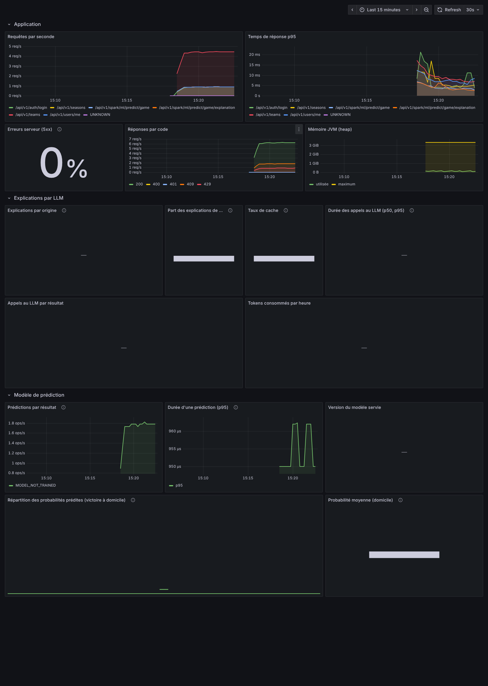

# HoopMind · backend

API de statistiques et de prédictions NBA : Spring Boot 4, PostgreSQL, Apache Spark ML.

## Démarrer en local

Prérequis : Java 21, Docker (pour PostgreSQL et les tests).

```bash
cp .env.example .env                     # puis renseigner DB_PASSWORD, JWT_SECRET, HOOPMIND_ADMIN_PASSWORD
docker compose up -d postgres            # base PostgreSQL 17
set -a && . ./.env && set +a
./mvnw spring-boot:run                   # API sur http://localhost:8083
```

- `JWT_SECRET` : `openssl rand -base64 48`
- Au premier démarrage, un administrateur est créé à partir de `HOOPMIND_ADMIN_*` s'il n'en existe aucun.
- Spark démarre en mode `local[*]` dans la JVM. `SPARK_ENABLED=false` démarre l'API sans Spark ;
  `docker compose --profile spark-cluster up -d` lance un cluster Spark 4.2 (avec `SPARK_MASTER=spark://spark-master:7077`).
- Tout en conteneurs : `docker compose --profile app up -d --build` (base, API en profil `prod` et frontend nginx sur http://localhost:8081 ; l'API et PostgreSQL ne sont ouverts que sur la machine locale).

### Charger les données NBA

Les données ne sont pas fournies avec le dépôt (voir [Données NBA](#données-nba)). Tout se fait depuis la page
**Administration > Données** du frontend :

1. **Matchs et résultats** : si vous avez déjà téléchargé la base, placez `nba.sqlite` dans `data/` (ou indiquez son
   chemin dans `NBA_DATABASE_PATH`) puis cliquez sur « Réimporter le fichier présent ». Sinon, renseignez `KAGGLE_USERNAME` et `KAGGLE_KEY` dans `.env` (jeton créé sur kaggle.com, Settings,
   API, Create New Token), puis cliquez sur « Télécharger depuis Kaggle et importer ». Le serveur télécharge la base de
   Wyatt Walsh lui-même (plusieurs Go, sans passer par le navigateur) puis l'importe en arrière-plan ; la page suit l'avancement.
   La base s'arrête à 2022-23 : pour les saisons suivantes, téléchargez `Games.csv` et `TeamStatistics.csv` du jeu Kaggle
   [eoinamoore/historical-nba-data-and-player-box-scores](https://www.kaggle.com/datasets/eoinamoore/historical-nba-data-and-player-box-scores),
   déposez-les dans `data/eoinamoore/` (ou `EOINMOORE_DATA_DIR`), puis cliquez sur « Importer 2023-24 ».
2. **Statistiques de saison et trophées** : déposez le zip de l'archive de Sumitro Datta, ou des CSV isolés, dans n'importe
   quel ordre. Chaque fichier est reconnu par ses colonnes, quel que soit son nom, et la page affiche un compte rendu par fichier.
3. **Modèle** : choisissez le nombre de saisons et lancez l'entraînement ; la page affiche la précision, la comparaison aux
   règles simples et le poids de chaque variable.

Sans interface, les mêmes opérations existent dans l'API (jeton administrateur) :

```bash
scripts/download-nba-database.sh         # ou téléchargement manuel de data/nba.sqlite
curl -X POST "localhost:8083/api/v1/admin/imports/nba-database/jobs?seasons=10" -H "Authorization: Bearer $TOKEN"
curl -X POST "localhost:8083/api/v1/admin/imports/eoin-moore/jobs?fromYear=2023&toYear=2023" -H "Authorization: Bearer $TOKEN"
curl -X POST "localhost:8083/api/v1/admin/imports/csv" -F "files=@archive.zip" -H "Authorization: Bearer $TOKEN"
curl -X POST "localhost:8083/api/v1/spark/ml/train/game-outcome/jobs?seasons=5" -H "Authorization: Bearer $TOKEN"
curl "localhost:8083/api/v1/spark/ml/train/game-outcome/status" -H "Authorization: Bearer $TOKEN"
```

`NBA_IMPORT_ON_STARTUP=true` lance l'import au démarrage. Chaque import est rejouable : il met à jour les lignes existantes sans créer de doublon.

## Documentation de l'API

Swagger UI : http://localhost:8083/swagger-ui.html, réservé aux administrateurs (identifiants HoopMind en HTTP Basic).
Pour appeler les routes protégées depuis Swagger, obtenir un jeton avec `POST /api/v1/auth/login` puis cliquer sur **Authorize**.
La documentation est désactivée en profil `prod`.

## Tests

```bash
./mvnw verify
```

Les tests d'intégration démarrent PostgreSQL avec Testcontainers et passent par toute la chaîne (HTTP, sécurité, JPA, Liquibase).
Sans Docker : `./mvnw verify -Dhoopmind.test.testcontainers=false -Dspring.datasource.url=jdbc:postgresql://localhost:5432/hoopmind_test -Dspring.datasource.username=... -Dspring.datasource.password=...`.

`ModularityTests` vérifie les frontières entre modules avec Spring Modulith et génère leur documentation dans `target/spring-modulith-docs`.

## Architecture

Monolithe modulaire, découpé par fonctionnalité (`com.np3tech.hoopmind.*`) :

| Module | Rôle |
|---|---|
| `user` | Comptes, profils, rôles, administration des utilisateurs. API publique : `UserAccountService` et l'événement `UserCredentialsRevoked`. |
| `auth` | Connexion, jetons, configuration Spring Security (API et Swagger). Dépend de `user`, jamais l'inverse. |
| `nba` | Équipes, joueurs, saisons, matchs, statistiques, blessures. |
| `audit` | Journal d'audit : qui a fait quoi, sur quel compte, avec quel résultat. Les autres modules publient un `AuditEvent`. |
| `ml` | Prédictions et analyses. Le reste de l'application passe par le port `GameOutcomePredictor` ; l'implémentation Spark vit dans `ml.spark`. L'explication par LLM passe par le port `PredictionExplainer` (`ml.explanation`). |
| `shared` | Configuration commune, erreurs, e-mail. |

**Choix assumés**

- *Monolithe modulaire plutôt que microservices* : un seul déployable, des frontières vérifiées par les tests (Spring Modulith).
- *Hexagonal ciblé* : un port uniquement là où il y a une vraie frontière technique (le moteur de prédiction, le LLM qui l'explique). Le reste est du Spring classique par fonctionnalité, plus simple à lire.
- `nba` et `ml` sont déclarés « ouverts » : le code ML existant utilise directement les entités NBA. Ils seront refermés lors du chantier ML.
- Le schéma appartient à Liquibase ; Hibernate se contente de le valider (`ddl-auto: validate`).
- Toutes les erreurs suivent la RFC 9457 (`application/problem+json`).

### Sécurité

- Jeton d'accès JWT (HS256, 15 min) signé et vérifié par Spring Security OAuth2 Resource Server ; les rôles sont dans la claim `roles`.
- Jeton de rafraîchissement opaque (7 jours) dans un cookie `HttpOnly`, `SameSite=Strict`, limité à `/api/v1/auth`. Seule son empreinte SHA-256 est stockée.
- Rotation à chaque usage, avec détection de réutilisation : rejouer un ancien jeton révoque toute la session.
- Changer de mot de passe, être désactivé, changer de rôles ou être supprimé révoque immédiatement toutes les sessions de l'utilisateur.
- Mots de passe hachés en bcrypt (`DelegatingPasswordEncoder`, migration d'algorithme possible).
- Journal d'audit des actions sensibles (voir ci-dessous).
- Aucun secret dans le dépôt : tout passe par des variables d'environnement (`.env.example`).

### Journal d'audit

Sont tracés : inscriptions, connexions et échecs de connexion, déconnexions, réutilisation d'un jeton de rafraîchissement,
modifications de profil, changements (et échecs de changement) de mot de passe, création de l'administrateur initial,
et toutes les actions des administrateurs sur les comptes (activation, désactivation, rôles, suppression), y compris celles refusées.

- Chaque événement garde l'auteur, le compte concerné, la date, le résultat et un motif. Les noms sont copiés pour rester
  lisibles après la suppression d'un compte.
- Pas d'adresse IP, pas de mot de passe, pas de valeur saisie : un profil modifié ne garde que le nom des champs, et une
  connexion avec un identifiant inconnu n'enregistre pas cet identifiant (il peut contenir un mot de passe tapé dans le mauvais champ).
- Une réussite n'est enregistrée que si l'action est validée ; un échec l'est toujours. L'écriture se fait dans une transaction
  séparée et ne peut pas faire échouer l'action.
- Les événements sont aussi écrits dans le journal applicatif `hoopmind.audit`, et supprimés après `AUDIT_RETENTION` (365 jours par défaut).
- Consultation : `GET /api/v1/admin/audit-events` (filtres `action`, `outcome`, `userId`, `user`, `from`, `to`) et la page *Administration → Journal d'audit*.

### Routes principales

| Méthode | Route | Accès |
|---|---|---|
| POST | `/api/v1/auth/register`, `/login`, `/refresh`, `/logout` | public |
| GET, PATCH | `/api/v1/users/me` | connecté |
| PUT | `/api/v1/users/me/password` | connecté |
| GET | `/api/v1/admin/users?search=&page=&size=` | ADMIN |
| GET, DELETE | `/api/v1/admin/users/{id}` | ADMIN |
| PUT | `/api/v1/admin/users/{id}/status`, `/roles` | ADMIN |
| GET | `/api/v1/admin/audit-events?action=&outcome=&userId=&user=&from=&to=` | ADMIN |
| GET | `/api/v1/teams`, `/players`, `/games`, `/seasons`, `/stats`… | public |
| GET | `/api/v1/admin/imports/nba-database/status` | ADMIN |
| POST | `/api/v1/admin/imports/nba-database/jobs?seasons=&download=` (arrière-plan) | ADMIN |
| POST | `/api/v1/admin/imports/csv` (multipart `files`), GET `/csv/datasets` | ADMIN |
| POST | `/api/v1/spark/ml/train/game-outcome/jobs?seasons=` (arrière-plan), GET `/train/game-outcome/status` | ADMIN |
| GET | `/api/v1/spark/ml/model-metrics`, `/ml/predict/game`, `/ml/predict/game/explanation` | connecté |
| * | `/api/v1/spark/**` | connecté (entraînement : ADMIN) |

## Données NBA

| Source | Contenu | Utilisation |
|---|---|---|
| [NBA Basketball Database](https://www.kaggle.com/datasets/wyattowalsh/basketball) de **Wyatt Walsh** ([nbadb](https://github.com/wyattowalsh/nbadb)), licence CC BY-SA 4.0 | Tous les matchs depuis 1946-47 avec scores, feuilles de match, classements, issus de stats.nba.com | Équipes, saisons, matchs, résultats, statistiques par match et bilans de saison |
| [Historical NBA Data and Player Box Scores](https://www.kaggle.com/datasets/eoinamoore/historical-nba-data-and-player-box-scores) de **Eoin Moore** | Tous les matchs et feuilles de match d'équipe, mis à jour chaque jour | Saisons absentes de la base Walsh (2023-24 et suivantes) : matchs, play-in, résultats avec points par quart-temps, statistiques par match et bilans de saison |
| [stats.nba.com](https://www.nba.com/stats), site officiel de la NBA, public | Journal des matchs par équipe (`leaguegamelog`) | Saisons récentes absentes de la base Walsh : matchs, résultats, statistiques par match et bilans de saison, sans les points par quart-temps |
| [NBA Stats (1947-present)](https://www.kaggle.com/datasets/sumitrodatta/nba-aba-baa-stats) de **Sumitro Datta**, d'après Basketball-Reference | Statistiques de saison des joueurs et des équipes, votes des trophées individuels | Importée telle quelle (table `reference_csv_rows`), pour la future prédiction des trophées (MVP, DPOY, ROY…) |

Les données ne sont pas versionnées : chacun les télécharge depuis Kaggle, et `data/` est ignoré par git.
Merci à Wyatt Walsh, Eoin Moore et Sumitro Datta pour leur travail de collecte et de publication.

L'import (`ingestion.nbadb`) lit le fichier `nba.sqlite` en lecture seule. Il reconnaît seul les deux formats de la base :
le schéma en étoile de nbadb (`dim_game`, `fact_game_result`…) et l'ancien format à plat (`game`, `team`, `line_score`),
qui est celui réellement livré dans l'archive Kaggle en octobre 2026 et s'arrête à la saison 2022-23
(voir [ADR 0016](docs/adr/0016-ancien-format-kaggle.md)). Il ne garde que la saison régulière, le play-in et les playoffs
des `NBA_IMPORT_SEASONS` dernières saisons (10 par défaut). Il calcule ensuite le bilan de chaque équipe par saison
(victoires, domicile et extérieur, séries, ratings offensif et défensif, rythme) à partir des feuilles de match.

Les fichiers d'Eoin Moore donnent les saisons suivantes, avec les mêmes identifiants que la base Walsh : l'import garde
la saison régulière, le play-in et les playoffs des saisons choisies (voir [ADR 0018](docs/adr/0018-saisons-recentes-eoin-moore.md)).
Le play-in (type `PLAY_IN`) ne compte ni dans le bilan de saison régulière ni dans les classements.

Le complément stats.nba.com lit, pour chaque saison de la dernière en base à la saison en cours, le journal des matchs
de saison régulière et de playoffs (deux requêtes par saison, trois secondes d'écart), puis l'importe comme la base Walsh :
mêmes identifiants, donc les saisons communes sont mises à jour sans doublon (voir [ADR 0017](docs/adr/0017-complement-stats-nba.md)).
Depuis mars 2026, nba.com coupe tout client qui n'est pas un navigateur (empreinte TLS) : ce complément ne répond plus. S'il cesse de répondre en cours
de route, les saisons déjà lues sont importées et l'import suivant reprend à partir de la dernière saison en base.

L'import des CSV (`nba.importer.csv`) reconnaît les 22 fichiers de l'archive par leurs colonnes caractéristiques et range
chaque ligne sous sa clé naturelle (par exemple saison, ligue, joueur et équipe), avec ses valeurs en JSON : « NA » devient nul,
les nombres restent des nombres. Une ligne déjà présente n'est réécrite que si elle a changé.

## Modèle de prédiction des matchs

Une régression logistique Spark ML prédit la probabilité de victoire de l'équipe à domicile.

- **Variables** : pour chaque équipe, sa forme *avant* le match (bilan, dix derniers matchs, ratings offensif, défensif et net,
  jours de repos) et les écarts entre les deux équipes. Elles sont calculées avec des fenêtres Spark
  (`rowsBetween(unboundedPreceding, -1)`) : le modèle ne voit jamais le résultat qu'il doit prédire,
  contrairement à un bilan de fin de saison qui le contient déjà.
- **Début de saison** : le bilan de la saison passée compte comme 10 matchs, puis s'efface à mesure que l'équipe joue
  (prédictions possibles dès le premier jour). Sans import, un administrateur saisit les scores de la saison en cours
  (*Admin › Saisie des résultats*, `PUT /api/v1/games/{id}/result`) : la forme en tient compte à la prédiction suivante.
  Voir [ADR 0022](docs/adr/0022-forme-de-debut-de-saison.md).
- **Évaluation dans le temps** : le modèle apprend sur les saisons les plus anciennes et il est testé sur la plus récente.
  Le nombre de saisons se règle avec `ML_TRAINING_SEASONS` (5 par défaut) ou `?seasons=`, pour comparer la précision selon l'historique utilisé.
- **Références** : la précision est comparée à deux règles simples sur les mêmes matchs, « l'équipe à domicile gagne » et
  « l'équipe au meilleur bilan gagne ». Les métriques (précision, AUC, log loss, matrice de confusion, poids des variables)
  sont enregistrées à chaque entraînement et servies par `GET /api/v1/spark/ml/model-metrics`.
- Le modèle est enregistré dans `ML_MODEL_DIR` et rechargé au redémarrage.
- **Score** : le même entraînement ajuste deux régressions linéaires (points de chaque équipe) sur les points marqués et
  encaissés par match avant le match, le repos et les playoffs. La prédiction renvoie le score, l'écart, le total et
  l'erreur moyenne du modèle sur l'écart, comparée à une règle simple sans avantage du terrain.
  Voir [ADR 0023](docs/adr/0023-prediction-du-score.md).

## Explication des prédictions par un LLM

`GET /api/v1/spark/ml/predict/game/explanation` renvoie la prédiction, le poids de chaque facteur et une explication
en français, par exemple : « Boston part favori, surtout grâce à son net rating (+9,4 contre +1,2)… En revanche,
New York arrive plus reposé. »

- **Le modèle calcule, le LLM rédige.** La régression logistique se décompose exactement en une contribution par
  variable (`poids × valeur standardisée`). Le LLM ne reçoit que ces chiffres et a pour consigne de n'inventer
  aucun fait : il met en mots, il ne prédit pas.
- **Gratuit par défaut.** Un adaptateur « compatible OpenAI » couvre Google Gemini et Groq (offres gratuites),
  Ollama (local, sans clé) et OpenAI. Un adaptateur Anthropic couvre Claude. Le choix se fait par configuration :

  | Fournisseur | `LLM_PROVIDER` | `LLM_BASE_URL` | `LLM_MODEL` (exemple) |
  |---|---|---|---|
  | Google Gemini (gratuit, clé sur [AI Studio](https://aistudio.google.com/apikey)) | `openai-compatible` | `https://generativelanguage.googleapis.com/v1beta/openai` | `gemini-2.5-flash` |
  | Groq (gratuit) | `openai-compatible` | `https://api.groq.com/openai/v1` | `llama-3.3-70b-versatile` |
  | Ollama (local, sans clé) | `openai-compatible` | `http://localhost:11434/v1` | `llama3.2` |
  | Claude (payant) | `anthropic` | *(par défaut)* | `claude-haiku-5-5` |
  | Aucun | `none` *(par défaut)* | | |

  La clé (`LLM_API_KEY`) vient uniquement de l'environnement. Les modèles disponibles et les quotas gratuits
  changent souvent : vérifiez-les chez le fournisseur.
- **Toujours une réponse.** Nouvelles tentatives sur les erreurs passagères (429, 5xx, réseau), 4 appels simultanés
  au plus, cache des explications déjà générées, et, si le LLM ne répond pas, une explication rédigée sans lui
  (`fallback: true`).

### Pourquoi nos propres adaptateurs plutôt que Spring AI ?

Spring AI aurait fonctionné, mais il se serait logé *dans* l'adaptateur : l'architecture hexagonale (un port
`PredictionExplainer`, un adaptateur par famille d'API) était nécessaire de toute façon. Pour ce besoin (un appel,
texte en entrée, texte en sortie, sans streaming ni outils), écrire l'appel HTTP nous-mêmes a semblé plus juste :

- **moins de dépendances** à garder alignées avec Spring Boot 4.1, Spring 7 et Jackson 3 ;
- **tout est visible** : le prompt exact, les en-têtes, le délai et la politique d'erreurs (retenter un 429, jamais un 401) ;
- **testable sans framework** : les tests vérifient contre un faux serveur HTTP la requête réellement envoyée ;
- **même approche que [ledger-ai](https://github.com/NjanjiPhilippe/ledger-ai)**, où les adaptateurs OpenAI et
  Anthropic sont aussi écrits à la main derrière un port.

La limite est assumée : nous maintenons nous-mêmes les formats d'API, et il n'y a ni streaming ni appel d'outils.
Si un assistant conversationnel avec outils est ajouté, Spring AI (ou les SDK officiels) redeviendra le bon choix.
Le détail, avec les alternatives, est dans l'[ADR 0015](docs/adr/0015-explication-par-llm.md).

## Monitoring

```bash
# dans .env : METRICS_PASSWORD (openssl rand -base64 24)
docker compose --profile app --profile monitoring up -d --build
```

Grafana (http://localhost:3000, `admin` / `GRAFANA_ADMIN_PASSWORD`) ouvre directement le tableau de bord
« HoopMind », sur trois niveaux :

- **Application** : requêtes par route, temps de réponse p95, erreurs 5xx, mémoire de la JVM.
- **Explications par LLM** : origine de chaque explication (LLM, cache, texte de secours), durée des appels,
  échecs par type, tokens consommés par heure.
- **Modèle de prédiction** : prédictions par résultat, durée, version du modèle servie, et répartition des
  probabilités prédites, qui signale une dérive des données.



*Capture prise sur une API locale sans données NBA ni modèle entraîné : les prédictions échouent avec
`MODEL_NOT_TRAINED`, donc les panneaux du LLM et des probabilités restent vides tant que le modèle n'est pas
entraîné.*

Prometheus (http://localhost:9090) lit `/actuator/prometheus`, protégé par HTTP Basic (`prometheus` /
`METRICS_PASSWORD`) et fermé sans mot de passe. Détail des métriques dans l'[ADR 0019](docs/adr/0019-monitoring.md).

## Versions

Java 21 · Spring Boot 4.1.1 · Spring Security 7.1 · Hibernate 7.4 · Liquibase 5 · springdoc-openapi 3.1 · Spring Modulith 2.1 ·
Apache Spark 4.2.0 (Scala 2.13) · PostgreSQL 17 · Testcontainers 2.

Spark 4.2 est aligné sur Spring Boot 4.1 (Jackson 2.21, Jetty 12.1, Netty 4.2, ANTLR 4.13), ce qui règle le conflit ANTLR qui faisait planter Spark avec Hibernate.
Spark garde Jackson 2 alors que Spring Boot 4 utilise Jackson 3 : les deux cohabitent sans conflit (paquets différents).

## Historique du projet

Le socle fonctionnel a été conçu et écrit par Saiko (NjanjiPhilippe) entre novembre et décembre 2025 :

| Date | Travail |
|---|---|
| 19/11/2025 | Création du projet Spring Boot |
| 21/11/2025 | Configuration Docker (PostgreSQL, cluster Spark) |
| 26/11/2025 | Modèle de données NBA (19 tables), schéma Liquibase, entités, dépôts, services et contrôleurs REST, authentification JWT et sécurité par rôles |
| 10/12/2025 | Préparation des tests |
| 13/12/2025 | Corrections et configuration Docker |

Ce socle comprend notamment toute la partie NBA (équipes, joueurs, saisons, matchs, statistiques, blessures, rapports) et le pipeline Spark ML
(préparation des données, forêt aléatoire, régression logistique, prédiction de score, analyses).

En octobre 2026, avec l'aide de Claude (Anthropic) :

- migration vers Spring Boot 4.1 et Spark 4.2, mise à jour de toutes les dépendances ;
- réorganisation en modules par fonctionnalité, vérifiés par Spring Modulith ;
- réécriture de l'authentification (Resource Server, jetons de rafraîchissement rotatifs) et gestion des utilisateurs (profil, administration) ;
- Swagger réservé aux administrateurs ;
- secrets sortis du dépôt, erreurs au format RFC 9457, tests d'intégration sur PostgreSQL, intégration continue.
- import des données NBA de Wyatt Walsh et modèle de prédiction des matchs évalué sur une saison réservée ;
- page « Données » : téléchargement de la base Walsh par le serveur depuis Kaggle, dépôt des CSV de Sumitro Datta reconnus automatiquement, entraînement du modèle.
- explication des prédictions en français par un LLM (Gemini, Groq, Ollama, OpenAI ou Claude), derrière un port, sur le modèle des adaptateurs de ledger-ai.
